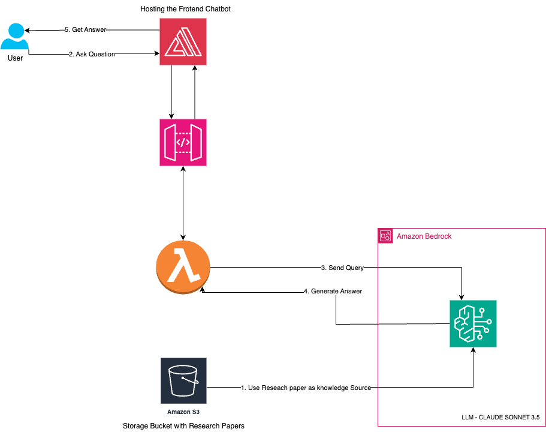

# Research Assistant Chatbot System

This repository contains a research assistant chatbot system that allows users to interact with a chatbot interface, ask research-related questions, and get detailed answers based on uploaded research papers. This system leverages AWS cloud services and Amazon Bedrock's language model capabilities to provide accurate responses to users' queries.

## Disclaimers
Customers are responsible for making their own independent assessment of the information in this document.

This document:

(a) is for informational purposes only,

(b) references AWS product offerings and practices, which are subject to change without notice,

(c) does not create any commitments or assurances from AWS and its affiliates, suppliers or licensors. AWS products or services are provided "as is" without warranties, representations, or conditions of any kind, whether express or implied. The responsibilities and liabilities of AWS to its customers are controlled by AWS agreements, and this document is not part of, nor does it modify, any agreement between AWS and its customers, and

(d) is not to be considered a recommendation or viewpoint of AWS.

Additionally, you are solely responsible for testing, security and optimizing all code and assets on GitHub repo, and all such code and assets should be considered:

(a) as-is and without warranties or representations of any kind,

(b) not suitable for production environments, or on production or other critical data, and

(c) to include shortcuts in order to support rapid prototyping such as, but not limited to, relaxed authentication and authorization and a lack of strict adherence to security best practices.

All work produced is open source. More information can be found in the GitHub repo.

## Table of Contents

- [Architecture Diagram](#architecture-diagram)
- [Infrastructure as Code](#infrastructure-as-code)
  - [Prerequisites](#prerequisites)
  - [Key Steps](#key-steps)
- [AWS Services Used](#aws-services-used)

## Architecture Diagram



### Overview

1. **Data Ingestion**: Research papers and knowledge documents are uploaded to an Amazon S3 bucket, serving as the primary data source for the chat assistant system.

2. **User Interaction**: Users interact with a ReactJS frontend application, hosted on Amazon Amplify. Users can input questions into the chatbot interface.

3. **Backend Processing**: User queries are sent to the backend via a WebSocket API request, handled by an AWS Lambda function.

4. **Response Generation**: The Lambda function interacts with Amazon Bedrock, which uses the Claude Sonnet 3.5 LLM to analyze the documents and generate a response based on the research papers.

5. **Response Delivery**: The generated response is formatted and returned to the frontend, where users see the answer displayed in the chatbot interface.

## Infrastructure As Code

This project builds the AWS infrastructure using AWS CDK (Cloud Development Kit) to deploy the React frontend using Amplify and to manage Lambda functions, Bedrock backend, and integration via WebSocket API.

### Prerequisites

- **GitHub Access**: Fork this repository in your GitHub environment and clone it in your preferred IDE. You will also need to change the owner name in `backend-stack.ts` located in the `cdk_backend` directory to enable access via Amplify.
  ```bash
  git clone <GitHub Repository URL>
  ```

- **AWS Bedrock Access**: Ensure your AWS account has access to the Claude 3.5 V2 model and Titan Embed text v2 in Amazon Bedrock in `us-west-2`. Request access through the AWS console if not already enabled.

- **GitHub Security Token Access**: You need a GitHub access token with repository access.

- **Python**: The project uses Python for some components. Install Python (version 3.7 or later).

- **Node.js**: Install Node.js.

- **Typescript**: Typescript 3.8 or later (optional).

- **AWS CLI**: Install AWS CLI to interact with AWS services and set up credentials.

- **AWS CDK**: Install AWS CDK for defining cloud infrastructure in code.

- **Docker**: Install Docker, as it is required to build and run Docker images for ECS tasks.

- **AWS Account Permissions**: Ensure your AWS account has the necessary permissions to create and manage resources like S3, Lambda, ECS, CloudWatch, etc.

### Key Steps

#### 1. Clone the Repository

Clone the repository that contains the CDK code, Docker configurations, and Lambda functions.

```bash
git clone <GitHub Repository URL>
```

#### 2. Fork the Repository

Fork the repository in your GitHub environment and change the owner name in `cdk_backend/lib/cdk_backend-stack.ts` at line 134 to replace `owner: 'ASUCICREPO'` with your GitHub username to enable access via Amplify.

#### 3. Directory Structure

Ensure the following structure:
```
main/
├── cdk_backend/
└── frontend/
```

#### 4. Running the Project

**Set Up Your Environment**
- Configure AWS CLI with your AWS account credentials:
  ```bash
  aws configure
  ```

**Set Up CDK Environment**
- Bootstrap your AWS environment for CDK (run only once per AWS account/region).
  ```bash
  cd cdk_backend
  cdk bootstrap
  ```

**Connect to ECR**
- Run the following command to connect to Amazon ECR (ensure Docker Desktop is running):
  ```bash
  aws ecr get-login-password --region us-east-1 | docker login --username AWS --password-stdin <ACCOUNT_ID>.dkr.ecr.us-east-1.amazonaws.com
  ```

**Deploy the CDK Stack**
- Deploy the stack to AWS:
  ```bash
  cdk deploy -c githubToken=<Your personal Token here>
  ```
- Deployment may take between 5 to 15 minutes, depending on Docker image upload time to ECR.

**Post Deployment**
- A new S3 bucket will be created. Upload research papers to it, and the ingestion job will start automatically. You can track the progress in the AWS Bedrock service.
- The frontend application will also be visible in Amplify. Allow some time for it to go live.

**Deleting the Infrastructure**
- To destroy the infrastructure, use the following command:
  ```bash
  cdk destroy
  ```

## AWS Services Used

This system leverages the following AWS services to create a scalable, reliable, and real-time chat assistant:

- **Amazon S3**: Stores research papers and knowledge documents.
- **Amazon Amplify**: Hosts the frontend ReactJS application.
- **AWS Lambda**: Manages backend processing and API routing.
- **Amazon API Gateway**: Handles WebSocket API requests.
- **Amazon Bedrock Knowledge Base**: Analyzes documents and generates responses using Claude Sonnet 3.5.
- **Amazon OpenSearch**: Used for searching relevant documents.

## License

This project is licensed under the [MIT License](LICENSE).

## Contact

For any queries, feel free to open an issue or contact the project maintainers.
